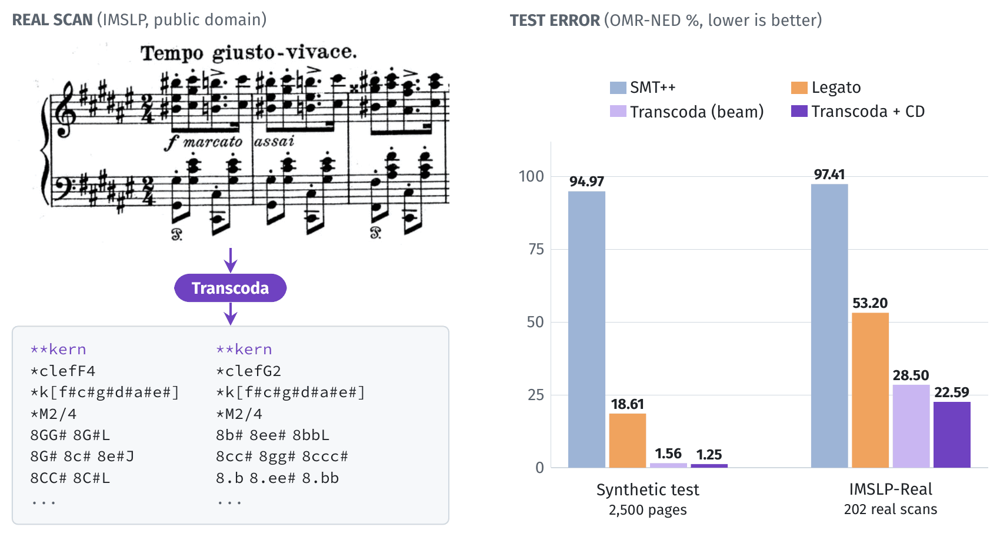
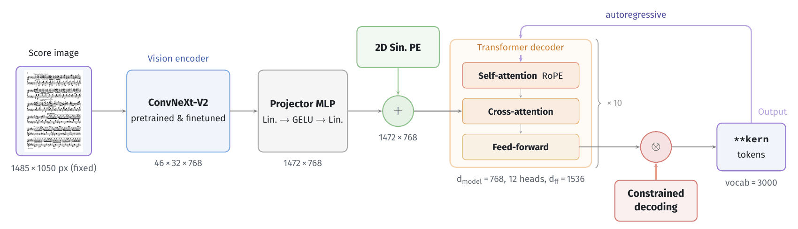
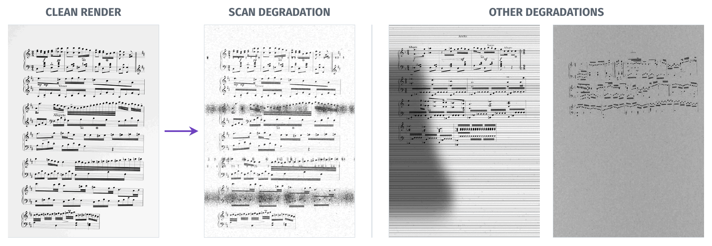
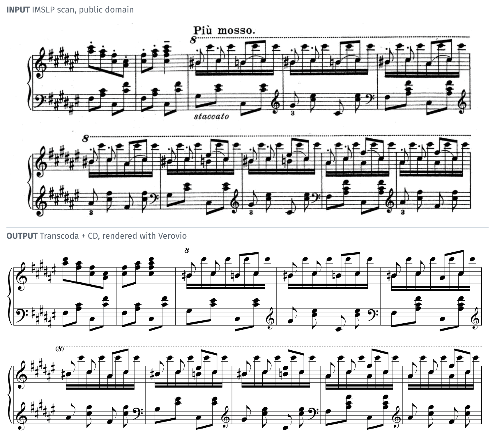

# Transcoda V2.1

**Full-page optical music recognition: score image in, Humdrum `**kern` out.**

[](#citation)
[](https://huggingface.co/btrkeks/transcoda-v2.1)
[](https://huggingface.co/datasets/btrkeks/transcoda-synthetic-test)
[](LICENSE)
[](NOTICE.md)

<p align="center">
  
</p>
<p align="center"><sub>Scan: Liszt, Hungarian Rhapsody No. 2, <a href="https://imslp.org/wiki/File:PMLP12453-Liszt_Klavierwerke_Peters_Sauer_Band_1_02_Ungarische_Rhapsodie_No_2_scan.pdf">IMSLP file 300584</a>, public domain. Scores: mean OMR-NED from <code>evaluation/</code>.</sub></p>

Transcoda reads printed sheet music and outputs Humdrum `**kern` notation.
It uses a 108M-parameter vision encoder and Transformer decoder, trained on synthetic pages only.
The constrained decoder checks syntax and spine structure and pads short voices with invisible rests.

## Results

Results from the NeurIPS 2026 paper, in OMR-NED percent. Lower is better.
Intervals are 95% document-cluster bootstrap intervals.

| Decoding | Synthetic test (2,500) | IMSLP-Real (202) | IMSLP-Real renderability |
| --- | ---: | ---: | ---: |
| Beam search | 1.56 | 28.50 [23.71, 34.14] | 89.1% |
| Constrained greedy (default) | 1.25 | 22.59 [18.87, 27.21] | 100.0% |

The [model card](docs/model-card.md) describes intended use and limits.
The V1 code stays at tag `v1`.

## Quickstart

### Install

Use Python 3.12, [uv](https://docs.astral.sh/uv/), Rust, CMake, a C++ compiler,
and libvips, Cairo and Pango system libraries. Run commands from this directory.
On Debian or Ubuntu:

```sh
sudo apt-get install build-essential cmake pkg-config libvips-dev libcairo2-dev libpango1.0-dev poppler-utils parallel
uv sync --frozen --all-extras
cargo build --locked --release
make -C vendor/musicxml2hum release -j 2
bash scripts/setup_verosim.sh
```

`--all-extras` installs CPU PyTorch. For CUDA, omit `cpu` and select the PyTorch
wheel for your CUDA installation:

```sh
uv sync --frozen --extra train --extra data --extra eval --extra constraints
```

The build fetches pinned external source revisions listed in
[release/external-revisions.json](release/external-revisions.json).
The parser's Noncommercial license applies in addition to the code license.

### Read a page

```sh
uv run --no-sync python scripts/infer.py --image score.png --out score.krn
```

This downloads the released checkpoint when no local copy exists and verifies its SHA-256.
Model and dataset IDs are configured once in [config/artifacts.json](config/artifacts.json).
Use `--device cuda` for a GPU, `--checkpoint path.ckpt` for a local checkpoint,
or `--mode beam` for unconstrained beam search.
Input images are resized to width 1050, then padded or cropped to height 1485.
No whitespace trim or layout normalization is applied in the paper runs.

## How it works

<p align="center">
  
</p>

A ConvNeXt-V2 encoder reads the whole page at a fixed size.
A 10-layer Transformer decoder writes `**kern` tokens one at a time.
With constrained decoding, tokens that would break `**kern` syntax or spine structure are masked.

<p align="center">
  
</p>
<p align="center"><sub>Pages rendered from GrandStaff test pieces (MIT) with the released generator, seed 7.</sub></p>

All training pages are synthetic. The generator renders public `**kern` sources with
Verovio in dense, varied layouts. It adds performance markings that are not part of the
target, then scan defects such as ink bleed, shadows, scanner noise and dirty rollers.
The [generation guide](docs/data-generation.md) has the details.

<p align="center">
  
</p>
<p align="center"><sub>Liszt, Hungarian Rhapsody No. 2, IMSLP file 300584 (public domain), systems 4 and 5 of printed page 26. This page scores 1.28% OMR-NED, one of the better IMSLP-Real pages. The benchmark mean is 22.59%.</sub></p>

Figure sources and image provenance are in [docs/figures/src](docs/figures/src/README.md).

## Reproduce the reported scores

Predictions, references, frozen scores and summaries are in `evaluation/`.
No images or weights are needed to rescore them. Build the parser and VeroSim first.
Use a new output directory for each run:

```sh
uv run --no-sync python scripts/verify_tools.py --cohort public --mode constrained --out outputs/public-cd
uv run --no-sync python scripts/verify_tools.py --cohort public --mode beam --out outputs/public-beam
uv run --no-sync python scripts/verify_tools.py --cohort synthetic --mode constrained --out outputs/synthetic-cd
uv run --no-sync python scripts/verify_tools.py --cohort synthetic --mode beam --out outputs/synthetic-beam
uv run --no-sync python scripts/verify_paper.py
```

These commands check each page, both bootstrap intervals, renderability,
symbol-count thirds and paired differences to frozen baseline scores.
A tool mismatch fails the check. Failed predictions score 100. No output repair is applied.
The Transcoda conversion route includes the parser's validity checks.
See [evaluation details](docs/evaluation.md).

## Regenerate predictions

```sh
uv run --no-sync python scripts/download_assets.py synthetic-test
uv run --no-sync python scripts/predict.py --dataset data/synthetic-test --mode constrained --out outputs/synthetic-cd.jsonl
uv run --no-sync python scripts/predict.py --dataset data/synthetic-test --mode beam --out outputs/synthetic-beam.jsonl
uv run --no-sync python scripts/predict.py --release evaluation/imslp-real-public.json --images data/imslp-public-images --mode constrained --out outputs/public-cd.jsonl
```

Use `--mode beam` for public beam predictions. Both modes use fp32,
a maximum of 2048 tokens, repetition penalty 1.1 and length penalty 1.0.
Beam width is 3. Constrained decoding is greedy, with the timeline rule enabled.
To score regenerated predictions, follow [docs/evaluation.md](docs/evaluation.md).

## Obtain IMSLP-Real scans

IMSLP-Real lives in this repository as references and scan metadata.
The [dataset card](docs/imslp-real-card.md) describes selection and annotation.
Scans remain on IMSLP. Review each file's terms in
[evaluation/imslp-file-licenses.tsv](evaluation/imslp-file-licenses.tsv).

```sh
uv run --no-sync python scripts/download_imslp.py
# Save each permitted PDF as data/imslp-pdfs/<file_id>.pdf.
uv run --no-sync python scripts/download_imslp.py --pdf-dir data/imslp-pdfs --out data/imslp-public-images
```

The helper prints the 79 IMSLP file links and extracts only the approved 202 pages.
It can also download direct PDF links you supply after reviewing the terms:

```sh
# urls.tsv columns: imslp_file_id and url
uv run --no-sync python scripts/download_imslp.py --download-urls urls.tsv --pdf-dir data/imslp-pdfs --download-only
```
You obtain the PDFs after following IMSLP's access and license steps.
Rasterization and crop differences can change predictions. The original evaluated scans are not included,
apart from README figure crops of one public-domain page.

## Generate data and train

The [generation guide](docs/data-generation.md) covers source acquisition,
conversion, label fixes, continuation pages, rendering and degradation.
Fetch PDMX, GrandStaff and any KernScores files yourself under their source terms.
We do not redistribute KernScores encodings, rendered KernScores pages or the training snapshot.
Its release and shard hashes are retained as provenance in `release/training-data/`.
The released synthetic test split contains 1,500 PDMX and 1,000 GrandStaff pages only.

After generating training data and preparing your own real validation set:

```sh
WANDB_MODE=offline uv run --no-sync python train.py config/camera-ready-v2.1.json --fresh_run=True
```

The config uses batch 12, accumulation 11, seed 42, bf16, 10,695 updates,
2,000 warmup updates and cosine decay. The selected checkpoint is step 8715.
The original 134-page validation set is private. Exact checkpoint selection and
exact retraining cannot be reproduced from public assets alone.
The 307 additional test pages are also private.

## Licenses

Code, training configs and generation scripts: [AGPL-3.0](LICENSE).
`vendor/kern_parser`: PolyForm Noncommercial 1.0.0, for that directory only.
Weights: CC BY-NC 4.0. Original tokenizer, transcriptions, corrections and dataset metadata:
CC BY 4.0. Source-derived assets retain their upstream terms.
PDMX test material is CC BY 4.0; GrandStaff test material is MIT.
IMSLP-Real includes adapted references with source-specific disclosures in its
[dataset card](docs/imslp-real-card.md).
See [NOTICE.md](NOTICE.md) for all third-party notices and encoder weight terms.

## Citation

```bibtex
@inproceedings{transcoda2026,
  title = {Transcoda: End-to-End Zero-Shot Optical Music Recognition via Data-Centric Synthetic Training},
  author = {Dratschuk, Daniel and Swoboda, Paul},
  booktitle = {Advances in Neural Information Processing Systems},
  year = {2026}
}
```
